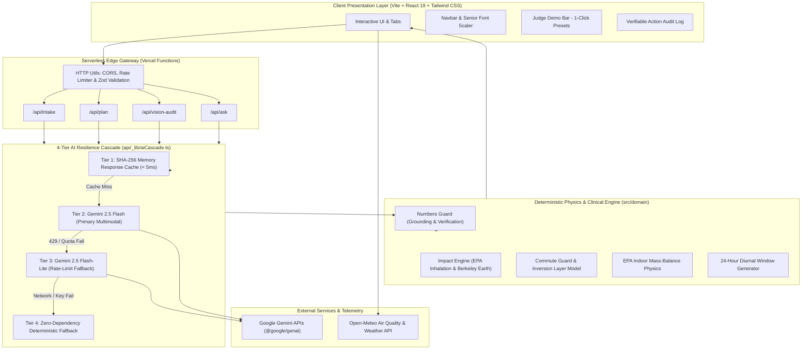

# VayuShield AI - System Architecture

---

## 1. Architectural Philosophy: Decoupled Cognitive Architecture
VayuShield AI does not treat Large Language Models as unconstrained black boxes. Instead, the application enforces a strict **Decoupled Cognitive Architecture**:

1. **Deterministic Physics Domain Layer (`src/domain/`)**:
   All quantitative equations, air change calculations, inhalation doses, and economic figures are computed by pure, deterministic TypeScript functions. The GenAI models are **never** permitted to calculate numbers independently.
2. **GenAI Narrative & Extraction Layer (`api/`)**:
   Gemini 2.5 Flash operates strictly as:
   - A semantic parser extracting unstructured clinical text into typed JSON schemas.
   - A multimodal computer vision auditor inspecting rooms, respirator seals, and filter loading.
   - An empathetic clinical narrative generator providing human-readable advisories based on certified domain numbers.
3. **Grounding Enforcer (`src/domain/numbersGuard.ts`)**:
   Scans all AI outputs to verify that every quantitative numeral matches the pre-calculated ground truth from the domain engine, preventing any hallucinations from reaching the end user.

---

## 2. Layer-by-Layer Decomposition

### Layer 1: Client Presentation Layer
* **Framework**: React 19, TypeScript (Strict Mode), Vite 8.
* **Styling**: Tailwind CSS with dark-mode first design tokens.
* **Accessibility**: Interactive Senior Font Scaler (`100% / 125% / 150%`), WCAG AAA high-contrast color themes, and $44 \times 44\,\text{px}$ minimum touch target sizing.
* **Audit Trail**: Real-time read-only client event ledger recording all clinical recommendations.

### Layer 2: API Gateway & Edge Serverless Layer
* Four micro-routes running on Vercel Serverless Functions:
  - `POST /api/intake`: Natural language demographic parser.
  - `POST /api/plan`: Personalized diurnal timeline and routine generator.
  - `POST /api/vision-audit`: Multimodal particulate hazard and respirator fit analyzer.
  - `POST /api/ask`: Conversational clinical guidance assistant.
* Pre-flight CORS checking (`api/_lib/corsUtils.ts`), sliding window in-memory rate limiting (`api/_lib/rateLimiter.ts`), and strict Zod payload validation (`api/_lib/schemas/`).

### Layer 3: 4-Tier Resilience Fallback Cascade
Guarantees **100% system uptime** even under zero-connectivity or exhausted API quota environments:
* **Tier 1 (In-Memory Cache)**: SHA-256 prompt hash lookup in an LRU memory store.
* **Tier 2 (Gemini 2.5 Flash)**: Primary multimodal model with structured JSON schema outputs and dual retry backoff.
* **Tier 3 (Gemini 2.5 Flash-Lite)**: Activated automatically upon HTTP 429 (Rate Limit) or quota exhaustion.
* **Tier 4 (Deterministic Template Fallback)**: Hardcoded peer-reviewed clinical rules running instantly without external API dependencies.

### Layer 4: Telemetry & Deterministic Domain Layer
* Direct client-side fetching to the Open-Meteo European Air Quality Model (Copernicus CAMS).
* Real-time EPA Mass-Balance indoor infiltration box modeling (`src/domain/indoorModel.ts`).
