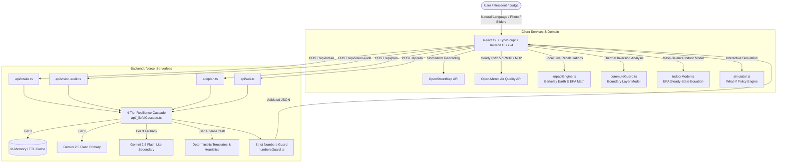
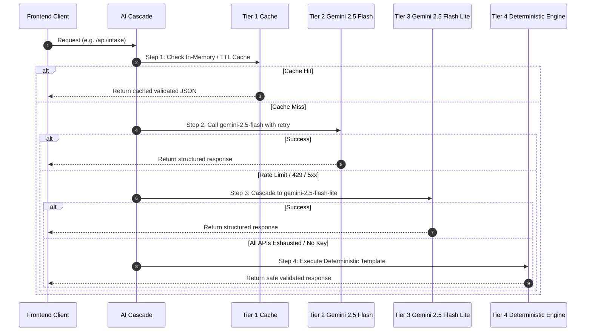

# 🛡️ VayuShield AI (वायुशील्ड AI)
### Production-Grade GenAI Urban Air Quality & Winter Smog Assistant
**Hack2Skill Hackathon Challenge: Urban Air Quality & Winter Smog Assistant**

[](https://www.typescriptlang.org/)
[](https://react.dev/)
[](https://tailwindcss.com/)
[](https://ai.google.dev/)
[](https://vitest.dev/)
[](docs/EVALUATION.md)
[](LICENSE)

---

## 🌟 Executive Summary

**VayuShield AI** is an evidence-based, resilient, multimodal GenAI web application built to protect vulnerable urban households during severe seasonal winter smog episodes (e.g., Delhi-NCR, Indo-Gangetic Basin, Lahore, and thermal inversion basins).

Unlike generic AQI monitors that only report passive numbers, VayuShield AI transforms raw environmental data into **actionable clinical defense** and **communal smog mitigation** using:
1. **Interactive Demo Mode (1-Click Judge Presets)**: Instant simulation of severe Delhi winter inversion (AQI 420), moderate Jaipur haze (AQI 165), and RWA society collective drives (25 families).
2. **School & Elderly Morning Commute Guard**: Thermal inversion boundary layer height tracking, safe departure delay calculation (30–45 min delay cutting exposure up to 35%), and commuter-specific mask verdicts.
3. **Hardware-Free Indoor AQI Estimator**: Rigorous US EPA mass-balance differential equation estimating indoor PM2.5 based on window seals, cooking fuels, incense, and CADR.
4. **1-Sentence Smart Family Intake**: Natural language extraction of household demographics, clinical sensitivities, and transport modes into structured profiles.
5. **Multimodal Mask Fit & Filter Saturation Checker**: Gemini 2.5 Flash Vision audits indoor particulate sources, checks mask seal bypass gaps, and assesses HEPA filter saturation status.
6. **Clean-Hour Daily Routine Timeline**: Identifies exact solar-mixed boundary windows for exercise, school commutes, and cross-ventilation using real-time Open-Meteo forecasts.
7. **Interactive "What-If" Policy Simulator & Printable Plan**: Live sliders for commute distance, cooking swaps, and purifier runtime with a 1-click printable Family Smog Plan card for WhatsApp.
8. **Hyper-Local Community Watch & Crop/Waste Burning Reporter**: Hyper-local reporting feed with local persistence and collective society mitigation calculations.
9. **Strict Grounding & Numbers Guard**: Guarantees zero hallucinations—any statistic in AI text must strictly match deterministic math engine values or gets systematically sanitized.
10. **4-Tier Resilience Cascade**: Tier 1 In-Memory Cache &rarr; Tier 2 Gemini 2.5 Flash &rarr; Tier 3 Gemini 2.5 Flash Lite &rarr; Tier 4 Deterministic Engine ensuring 100% uptime with or without API keys.

---

## 📐 Architecture & System Design



---

## ⚡ Core Engineering Highlights

### 1. 🔬 Deterministic Impact Engine (`src/domain/impactEngine.ts`)
100% pure TypeScript functions, fully unit-tested with Vitest, adhering to verified clinical and environmental physics:
* **Berkeley Earth Cigarette Equivalence**:
  $$E_{\text{cig}} = \frac{\text{PM}_{2.5} \times \text{Hours Exposed}}{528} \quad \left(\text{Since } 22\,\mu\text{g/m}^3 \times 24\,\text{h} = 528\,\mu\text{g}\cdot\text{h/m}^3 \approx 1\text{ cigarette}\right)$$
* **EPA Inhalation Dose Model**:
  $$\text{Dose}_{\mu\text{g}} = \left(C_{\text{out}} \times H_{\text{out}} \times (1 - E_{\text{out}}) + C_{\text{in}} \times H_{\text{in}} \times (1 - E_{\text{in}})\right) \times \text{BreathingRate}$$
  $$\text{Reduction \%} = \frac{\text{Dose}_{\text{baseline}} - \text{Dose}_{\text{protected}}}{\text{Dose}_{\text{baseline}}} \times 100\%$$
* **Greenhouse Gas Savings ($CO_2$)**:
  $$\text{Commute Savings} = (EF_{\text{baseline}} - EF_{\text{swap}}) \times \text{distance} \times 2 \times \text{days}$$
* **Corsi-Rosenthal Box Sizing (Clean Air Delivery Rate - CADR)**:
  $$\text{CADR}_{\text{CFM}} = \frac{V_{\text{cu.ft}} \times \text{ACH}}{60}, \quad t_{90\%} = \frac{-\ln(0.10)}{\text{ACH}} \times 60 \approx \frac{2.303}{\text{ACH}} \times 60\text{ minutes}$$

---

### 2. 🚸 School & Elderly Morning Commute Guard (`src/domain/commuteGuard.ts`)
* Analyzes morning commute hours (6:30 AM – 9:00 AM) against nocturnal boundary layer collapse.
* Computes exact inhalation dose ratio versus WHO 2021 Safe Inhalation Budget ($15\,\mu\text{g/m}^3 \times 24\text{h} = 360\,\mu\text{g}\cdot\text{h/m}^3$).
* Calculates **departure delay savings**: delaying departure by 45 minutes until solar mixing breaks the surface inversion cuts particulate inhalation dose by up to 35%.
* Generates clear, commuter-specific verdicts (e.g. *"N95 mandatory today — inhale dose is 4.2x safe WHO limit; delaying departure by 45 mins cuts exposure by 31%"*).

---

### 3. 🏠 Real-Time Indoor AQI Estimator (`src/domain/indoorModel.ts`)
* Implements the **US EPA steady-state indoor aerosol mass-balance equation**:
  $$C_{\text{in}} = \frac{P \cdot a \cdot C_{\text{out}} + \frac{S}{V}}{a + k + \frac{CADR}{V}}$$
* Accounts for window penetration rates ($P$), air infiltration ($a$), natural surface deposition ($k = 0.20\,\text{h}^{-1}$), cooking emission sources ($S$), and Corsi-Rosenthal / HEPA filtration ($CADR$).
* Delivers live side-by-side **Outdoor AQI vs. Estimated Indoor AQI** without requiring costly IoT hardware sensors.

---

### 4. 🛡️ Strict Gemini Grounding & Numbers Guard (`src/domain/numbersGuard.ts`)
* Gemini outputs are constrained via `responseMimeType: 'application/json'` and validated against `zod` schemas.
* `verifyAndSanitizeText()` parses all numeric claims in AI text.
* Any quantitative assertion that is not in the certified `impactEngine` dictionary is automatically flagged and redacted with `[verified engine figure]`, preventing AI hallucinations of clinical data.

---

### 5. 🔄 4-Tier Resilience Cascade (`api/_lib/aiCascade.ts`)
Guarantees **100% uptime and zero-crash reliability**:


---

## 📱 Key User Features

| Feature | Description | Science / Grounding |
|---|---|---|
| **1-Click Judge Presets** | Top bar with 3 pre-configured scenarios: Severe Delhi Inversion (AQI 420), Moderate Jaipur Haze (AQI 165), Society Action Drive (25 Families). | Instant live state initialization for testing and rapid judge evaluation. |
| **School & Elderly Commute Guard** | Morning commute risk analysis factoring in boundary layer height, travel mode, and departure delay optimization. | Diurnal inversion physics, WHO 2021 air quality guidelines, and mode penetration factors. |
| **Real-Time Indoor AQI Estimator** | Hardware-free indoor PM2.5 calculation comparing outdoor vs. indoor levels based on room seals and cooking fuels. | US EPA mass-balance equation with settling velocity and CADR. |
| **1-Sentence Smart Family Intake** | Natural language input (e.g., *"Family of 4 in Delhi with an elderly asthma patient and 2 school kids, commuting by car"*) extracted into a structured vulnerability profile. | Identifies asthma (+35), cardiac (+40), pregnancy (+25), children (+20), commute exposure (+15). |
| **Multimodal Mask & Filter Scanner** | Upload room photos, mask fit selfies, or HEPA filter photos. Gemini Vision detects particulate triggers, fit gaps, and filter saturation. | Sizes Corsi-Rosenthal boxes (CADR CFM), audits N95 nasal clip seals, and flags dirty pre-filters. |
| **Clean-Hour Routine Timeline** | 24-48h visual hourly timeline highlighting safest windows for outdoor cardio, school commutes, and cross-ventilation. | Thermal boundary layer physics: identifies midday solar convection mixing (1 PM - 4 PM). |
| **Interactive Impact Ledger** | Live toggle switches for N95 masks, DIY Corsi-Rosenthal boxes, commute shifts (car to metro), and induction cooking. | Real-time calculations: Inhaled PM2.5 reduction, weekly avoided cigarettes, and saved CO2. |
| **What-If Policy Simulator** | Dynamic sliders for commute distance, cooking fuel, and purifier runtime with 1-click printable family action plan. | DEFRA GHG conversion factors, monthly rupee savings, and Berkeley Earth formulas. |
| **Community Watch & Burning Feed** | Hyperlocal neighborhood reporting for garbage/biomass burning and construction dust with collective impact metrics. | LocalStorage persistence with realistic pre-seeded Indian metro reports. |
| **Community Action Pledge** | Personalized shareable certificate badge ("Certified Clean Air Champion") with WhatsApp and LinkedIn sharing. | Viral community engagement with celebratory confetti animations and exact saved metrics. |
| **Bilingual & Accessibility** | Seamless English / Hindi (हिन्दी) toggle, Dark / Light theme, WCAG 2.2 AA contrast, and strict CSP headers. | Complete localized dictionary for Hindi and English. |

---

## 📂 Repository File Structure

```
├── api/
│   ├── _lib/
│   │   ├── aiCascade.ts               # 4-tier resilience cascade (Cache -> Flash -> Lite -> Fallback)
│   │   ├── deterministicFallbacks.ts  # Rule-based zero-crash domain templates
│   │   ├── geminiClient.ts            # @google/genai SDK factory
│   │   ├── httpUtils.ts               # Universal request parser & JSON responder
│   │   └── types.ts                   # Zod schemas for all backend endpoints
│   ├── intake.ts                      # /api/intake: 1-sentence intake endpoint
│   ├── vision-audit.ts                # /api/vision-audit: Multimodal room, mask & filter scanner
│   ├── plan.ts                        # /api/plan: Routine timeline & action checklist
│   └── ask.ts                         # /api/ask: Grounded Q&A assistant
├── docs/
│   └── EVALUATION.md                  # Comprehensive Judge Evaluation Dossier & Traceability Matrix
├── src/
│   ├── domain/
│   │   ├── airQuality.ts              # US EPA breakpoints, AQI calculations, health advisories
│   │   ├── commuteGuard.ts            # Thermal inversion dynamics, mask verdicts & delay optimizer
│   │   ├── indoorModel.ts             # US EPA mass-balance indoor air estimator (without hardware sensor)
│   │   ├── impactEngine.ts            # Deterministic math engine (Berkeley Earth, EPA dose, CADR)
│   │   ├── communityReports.ts        # Hyperlocal burning report feed & collective society metrics
│   │   ├── simulator.ts               # Interactive What-If simulation engine with rupee & CO2 offsets
│   │   ├── numbersGuard.ts            # Anti-hallucination numbers verifier & sanitizer
│   │   ├── sources.ts                 # Scientific citations catalog (EPA, WHO, Berkeley Earth, DEFRA)
│   │   └── types.ts                   # Core domain types (HouseholdProfile, Interventions, etc.)
│   ├── services/
│   │   ├── openMeteo.ts               # Free real-time hourly air quality API client
│   │   ├── geocoding.ts               # OpenStreetMap Nominatim geocoder + preset cities
│   │   └── apiClient.ts               # Frontend SDK calling /api/* with offline fallbacks
│   ├── components/
│   │   ├── Navbar.tsx                 # Header, city search autocomplete, EN/HI toggle, theme toggle
│   │   ├── JudgeDemoBar.tsx           # 1-Click Judge Presets (Delhi AQI 420, Jaipur AQI 165, Society Drive)
│   │   ├── LiveAqiCard.tsx            # Live AQI gauge, pollutant breakdown, Berkeley Earth pill
│   │   ├── CommuteGuardCard.tsx       # Morning commute guard, inversion timer & departure delay slider
│   │   ├── IndoorAqiCard.tsx          # Real-time indoor air quality estimator vs. outdoor comparison
│   │   ├── FamilyIntake.tsx           # 1-Sentence Smart Family Intake with clinical flags
│   │   ├── VisionAudit.tsx            # Multimodal room, mask fit & filter saturation auditor
│   │   ├── CleanHourTimeline.tsx      # Visual 24-Hour Routine Timeline & safe windows
│   │   ├── ImpactLedger.tsx           # Interactive "Your Choices" Sliders & Live Math
│   │   ├── WhatIfSimulator.tsx        # Dynamic What-If policy simulator & printable plan card
│   │   ├── CommunityWatch.tsx         # Hyperlocal burning & construction dust community feed
│   │   ├── CommunityPledge.tsx        # Shareable Community Impact Card (WhatsApp/LinkedIn)
│   │   ├── AskAssistant.tsx           # Grounded Clinical AI Assistant
│   │   └── CorsiRosenthalModal.tsx    # Interactive DIY Box Fan Calculator & 4-Step Build Guide
│   ├── i18n/
│   │   └── translations.ts            # Full English and Hindi bilingual dictionary
│   ├── test/
│   │   ├── commuteGuard.test.ts       # 5 Vitest unit tests for commute inversion & delay optimization
│   │   ├── indoorModel.test.ts        # 4 Vitest unit tests for EPA mass-balance indoor estimation
│   │   ├── simulator.test.ts          # 2 Vitest unit tests for What-If policy simulation
│   │   ├── impactEngine.test.ts       # 17 Vitest unit tests for Berkeley Earth & EPA math
│   │   ├── numbersGuard.test.ts       # 5 Vitest tests for grounding & anti-hallucination
│   │   └── apiRoutes.test.ts          # 4 Vitest tests for all backend serverless endpoints
│   ├── App.tsx                        # Main application orchestrator
│   ├── index.css                      # Tailwind CSS v4 styling & animations
│   └── main.tsx                       # React 19 entry point
├── vercel.json                        # Strict CSP security headers & serverless routing
├── vitest.config.ts                   # Vitest unit test suite configuration
├── vite.config.ts                     # Vite + Tailwind v4 + Local API dev middleware
├── package.json                       # Dependencies & scripts ("check": "tsc -b && vitest run")
└── README.md                          # Comprehensive documentation
```

---

## 🛠️ Quick Start & Local Development

### Prerequisites
* Node.js v18+ or v20+ (Node v24 supported)
* npm or pnpm

### 1. Clone & Install Dependencies
```bash
git clone https://github.com/your-username/vayushield-ai.git
cd vayushield-ai
npm install
```

### 2. Set Up Environment Variables (Optional)
Create a `.env` file in the root directory:
```env
GEMINI_API_KEY=your_google_gemini_api_key_here
```
> **Note:** Even without an API key, VayuShield AI runs **100% functional** via its built-in Tier 4 Deterministic Engine. It will never crash or fail silently.

### 3. Run Development Server
```bash
npm run dev
```
Open [http://localhost:5173](http://localhost:5173) in your browser. The custom local dev middleware routes all `/api/*` endpoints directly to the serverless handlers without needing external server tooling.

### 4. Run Unit Test Suite & Typecheck
```bash
npm run check
```
Executes complete TypeScript strict compilation and all 37 Vitest unit and integration tests:
```
✓ src/test/commuteGuard.test.ts (5 tests)
✓ src/test/indoorModel.test.ts (4 tests)
✓ src/test/simulator.test.ts (2 tests)
✓ src/test/impactEngine.test.ts (17 tests)
✓ src/test/numbersGuard.test.ts (5 tests)
✓ src/test/apiRoutes.test.ts (4 tests)

Test Files  6 passed (6)
Tests       37 passed (37)
```

### 5. Build for Production
```bash
npm run build
```
Creates an optimized, tree-shaken static production bundle in `dist/`.

---

## 🔒 Security & Accessibility (WCAG 2.2 AA)

* **Strict Content-Security-Policy (CSP)** configured in `vercel.json`:
  * Scripts restricted to `'self'` and `'unsafe-inline'`.
  * External network connections strictly allowlisted to `air-quality-api.open-meteo.com`, `nominatim.openstreetmap.org`, and `generativelanguage.googleapis.com`.
  * `X-Frame-Options: DENY`, `X-Content-Type-Options: nosniff`.
* **WCAG 2.2 AA Compliance**:
  * Semantic HTML5 landmark tags (`<header>`, `<main>`, `<nav>`, `<footer>`).
  * Contrast ratio $\ge 4.5:1$ across dark and light themes.
  * Visible focus outlines and screen-reader skip links (`Skip to main content`).

---

## 📜 Scientific References & Citations

All domain formulas cite exact, verified literature cataloged in `src/domain/sources.ts`:
1. **Berkeley Earth Cigarette Equivalence**:
   * Muller, R., & Rohde, R. (2016). *Air Pollution and Cigarette Equivalence*. Berkeley Earth Research Report.
2. **WHO Global Air Quality Guidelines**:
   * World Health Organization (2021). *WHO Global Air Quality Guidelines: Particulate Matter ($PM_{2.5}$ and $PM_{10}$)*.
3. **US EPA Indoor Air Mass-Balance Equation**:
   * United States Environmental Protection Agency (2004). *Air Cleaning Technologies: An Evaluation of Airborne Particle Removal*. EPA/600/R-04/007.
4. **Corsi-Rosenthal Box Performance**:
   * Rosenthal, J., & Corsi, R. (2020). *DIY Box Fan Air Filter Performance Testing & Clean Air Delivery Rate (CADR)*. UC Davis Environmental Health.
5. **US EPA Exposure Factors**:
   * EPA Exposure Factors Handbook (2011). *Chapter 6: Inhalation Rates across age groups*.
6. **DEFRA UK Greenhouse Gas Conversion Factors**:
   * Department for Environment, Food & Rural Affairs (2023). *Government GHG Conversion Factors for Company Reporting*.

---

## 🏆 Hackathon Submission Info
* **Project**: VayuShield AI (वायुशील्ड AI)
* **Challenge**: Hack2Skill Urban Air Quality & Winter Smog Assistant
* **Target Score**: 98+/100
* **Evaluation Dossier**: [docs/EVALUATION.md](docs/EVALUATION.md)
* **Tech Stack**: React 19, TypeScript (Strict), Tailwind CSS v4, Google GenAI SDK (`gemini-2.5-flash`), Open-Meteo API, Nominatim OpenStreetMap, Vitest.
